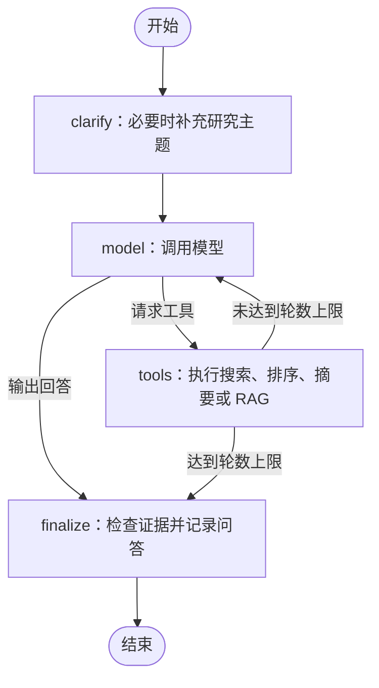

# ResearchPilot

一个基于 Python、OpenAlex、MCP 和 LangGraph 的命令行科研助手。通过自然语言完成论文搜索、引用量排序、摘要获取、缓存摘要语义检索，以及有来源的研究方法总结。

例如：

> 搜索 2023—2026 年 mechine learning 论文，最多 5 篇。在本次候选中按引用量选出前 2 篇，获取摘要，根据摘要比较研究方法，并附论文标题与链接。

## 当前能力

- **论文搜索**：通过 OpenAlex 按关键词和年份查询，返回标题、年份、DOI、引用量和论文 URL。
- **引用量排序**：对当前候选论文排序，保存选中的论文。
- **MCP 摘要工具**：发现 MCP 服务提供的 `get_paper_detail` 工具，获取并还原 OpenAlex 摘要。
- **摘要 RAG**：使用 `all-MiniLM-L6-v2`，从当前候选的有效缓存摘要中检索相关内容，供模型总结。
- **任务规划与证据检查**：代码调用 `run(..., target_papers=N)` 时生成计划，检查选中论文的摘要是否备齐。
- **多轮交互**：保留最近 3 轮完成的文本问答；主题不明确的指定短语会触发补充提问。
- **持久化与恢复**：SQLite 保存图执行状态和完整业务快照，支持重启后继续未完成任务；JSON 保存业务状态副本。

这是单用户 CLI 学习项目，研究方法总结依据可获得的摘要。当前不读取论文全文或 PDF。

## 执行流程

模型通过 Responses API 选择工具，Python 程序执行工具并返回结果。LangGraph 负责节点调度、中断和检查点。



其中搜索、排序和 RAG 由本地工具处理；摘要获取通过 HTTP MCP 服务调用 OpenAlex。当前实际入口使用 `build_agent_graph()`；`build_search_graph()` 是保留的固定流程学习示例。

## 快速开始

### 1. 安装依赖

需要 Python 3.11 或更新版本，以及 uv。在项目目录执行：

```bash
uv sync --frozen
```

项目通过 `uv.lock` 固定依赖，PyTorch 使用 CPU 源。首次启动还需下载嵌入模型；下载完成后会复用本地 Hugging Face 缓存。

### 2. 配置环境变量

首次配置时，将 `.env.example` 复制为 `.env`；已有 `.env` 时直接编辑现有文件。

```bash
cp .env.example .env
```

填入自己的配置。下面的地址、模型名和密钥均为占位值：

```dotenv
OPENAI_API_KEY=your-api-key
OPENAI_BASE_URL=https://your-provider.example/v1
OPENAI_MODEL=your-model-name
OPENALEX_API_KEY=your-openalex-api-key
```

| 变量 | 用途 |
| --- | --- |
| `OPENAI_API_KEY` | 模型服务密钥，程序启动时必需 |
| `OPENAI_BASE_URL` | 模型 API 基础地址，程序启动时必需 |
| `OPENAI_MODEL` | 模型名称，程序启动时必需 |
| `OPENALEX_API_KEY` | OpenAlex 密钥；配置后会随搜索与详情请求发送，实际权限和配额由服务决定 |
| `HF_TOKEN` | 可选的 Hugging Face 令牌，用于模型下载；已有缓存时通常不需要 |

模型服务必须支持项目使用的 **Responses API 和 Function Calling**。只支持 Chat Completions 的接口无法直接运行当前 Agent。

### 3. 启动 MCP 服务

在第一个终端执行，并保持运行：

```bash
uv run --frozen mcp run app/mcp_server.py --transport streamable-http
```

默认服务地址为 `http://127.0.0.1:8000/mcp`，Agent 当前连接 `http://localhost:8000/mcp`。修改服务地址时，需要同步修改 Agent 中的两个 `MCPClient` 连接位置。

### 4. 启动科研助手

在第二个终端执行：

```bash
uv run --frozen python app/agent/paper_search_agent.py
```

启动后会加载嵌入模型、发现 MCP 摘要工具并恢复历史状态：

- 有未完成任务时，优先恢复该任务。
- 没有候选论文时，自动运行一次雷达手势识别的示例任务。
- 已有候选论文时，进入交互提问。

仓库可能包含学习过程中保存的 `data` 文件，因此克隆项目后也可能直接恢复已有候选。

每次输入一行问题，输入 `exit` 结束。

## 使用示例

### 搜索与摘要比较

```text
搜索2023—2026年 radar gesture recognition 论文，最多5篇。在本次候选中按引用量选出前2篇，获取摘要，根据摘要比较研究方法，附标题和链接。没有摘要时明确说明。
```

### 对当前候选排序

```text
请在当前候选论文中按引用量选出前3篇，列出标题、年份、引用量和链接。
```

### 从缓存摘要中检索

先通过摘要工具获取需要的论文摘要，再提出：

```text
请调用 retrieve_saved_papers，query 使用 radar gesture recognition methods，top_k=2。根据结果总结方法，报告候选数、可检索摘要数、实际返回数，并附来源链接。
```

RAG 工具本身不会获取缺失摘要。可追加“不要重新搜索或获取详情，仅使用已有缓存”，检查缓存检索是否工作。

### 补充研究主题

```text
请帮我搜索论文
```

此类已定义的模糊短语会触发澄清。看到 `补充信息:` 后输入，例如：

```text
radar gesture recognition
```

澄清节点目前匹配固定短语，不是通用的语义意图分类器。

## 数据与恢复规则

| 文件 | 保存内容 |
| --- | --- |
| `data/state.json` | 论文、选中 ID、详情缓存、关键词、计划、目标和最近 3 轮文本问答 |
| `data/checkpoints.sqlite` | 消息、待执行工具、回答、模型调用次数、任务问题、完整业务快照和执行位置 |

启动时先读取 JSON，再读取 `main` 线程的最新检查点。如果检查点含有 `business_state`，优先使用它恢复论文业务状态，使数据与执行位置对应。

当前 CLI 使用 `thread_id="main"`，每个图任务最多调用模型 8 轮。普通交互调用 `run(query)`，默认不生成独立任务计划；初始示例通过 `target_papers=2` 启用计划和摘要准备检查。

恢复时需使用原数据库、线程 ID 和兼容的图定义。程序恢复的是节点执行：未完成节点可能重新执行，工具批次执行到一半时退出也可能导致该批次重跑。已完成任务的 `resume()` 直接返回保存的回答，不重复记录聊天历史。

早期没有 `business_state` 的未完成检查点不能用当前代码完整恢复。需要全新会话时，先停止 Agent，再把上述两个数据文件移到项目外备份，随后重新启动。不要只移走其中一个文件，否则另一个仍可能恢复历史状态。

## 检索范围与结果解释

- **搜索会替换候选集合**，不合并历次搜索结果。历史详情缓存保留，按规范化后的 OpenAlex URL 复用。
- 单次搜索 `limit` 范围是 1–100。引用量排序仅针对本次候选，不代表整个研究领域的全局排名；当前没有完整分页遍历。
- RAG 范围是 **当前候选论文 ∩ 已缓存的非空摘要**。不在当前候选中的旧缓存不会参与检索。
- `candidate_count` 是当前候选数，`searchable_count` 是可检索摘要数，`returned_count` 是本次实际返回数。`top_k` 限制返回数量，不表示只对这么多篇摘要计算相似度。
- 摘要缺失分为“尚未成功保存详情”和“详情已返回但摘要为空”。网络或 MCP 调用失败不等于论文没有摘要。
- 嵌入模型在 CPU 上运行，每个 Agent 实例加载一次。文档与查询向量归一化后用点积排序；每次检索重新计算向量，当前没有独立向量数据库或相关性阈值。返回结果不保证每篇都强相关。
- 当前模型建议使用英文检索词。摘要中的明确描述才能作为方法结论的依据；相似度、引用量都不能代替论文内容证据。

## 项目结构

```text
research-pilot/
├── app/
│   ├── agent/
│   │   ├── paper_search_agent.py  # 模型工具协议、LangGraph 和交互入口
│   │   └── state.py               # 业务状态、序列化、最近问答
│   ├── models/schemas.py          # Paper 与 TaskPlan
│   ├── tools/
│   │   ├── paper_search.py        # OpenAlex 搜索
│   │   ├── paper_rank.py          # 引用量排序
│   │   └── paper_detail.py        # 详情请求与倒排索引摘要还原
│   ├── rag/retriever.py           # TF-IDF 示例与语义检索实现
│   └── mcp_server.py              # MCP 摘要工具服务
├── tests/                        # 搜索、排序与基础 Agent 测试
├── data/                         # 运行状态和检查点
├── .env.example
├── pyproject.toml
└── uv.lock
```

## 验证

运行现有测试：

```bash
uv run --frozen pytest -q
```

测试覆盖搜索成功与空结果、字段映射、非法输入、HTTP 错误与超时、排序边界，以及 Agent 直接回答。Agent 测试会加载模型环境配置和真实嵌入模型，需要先完成环境变量配置和嵌入模型下载。单元测试不能替代真实模型、OpenAlex、MCP 和恢复流程的联合验收。

### 手动验收步骤

1. 运行上述搜索与比较示例，确认日志中实际出现搜索、排序和摘要工具调用，回答包含来源链接。
2. 调用 `retrieve_saved_papers`，核对 `returned_count <= searchable_count` 且 `returned_count <= requested_top_k`。
3. 输入 `exit` 后重启，再仅用缓存检索，确认候选、摘要仍可用。
4. 输入“请帮我搜索论文”，在等待补充主题时按 `Ctrl+C` 退出；重启后应继续提示补充，输入主题后完成搜索。

### 本次联合验收

验收日期：2026-11-06。使用已配置的真实模型接口、OpenAlex、HTTP MCP 服务和本地嵌入模型完成以下检查：

| 检查项 | 实际结果 |
| --- | --- |
| 现有自动化测试 | 16 项通过 |
| 搜索、排序和 MCP 摘要 | 搜索返回 5 篇候选，正确选出引用量前 2 篇，获取 2 份有效摘要 |
| RAG 与方法总结 | 5 篇候选、2 篇可检索摘要、返回 2 条结果；回答包含所选论文来源链接，方法概括与摘要相符 |
| 图任务收尾 | 5 轮图内模型调用后结束，业务对象与检查点一致，JSON 保存与读取一致 |
| 数据库重开与缓存检索 | 重新创建连接及 Agent 后，论文和摘要保留；后续检索仅调用 RAG 工具 |
| 已完成任务恢复 | 返回保存的回答，不重复追加聊天历史 |
| 实际 CLI 跨进程恢复 | 等待补充主题时 Ctrl+C 退出；新进程优先恢复待完成任务，补充主题后完成真实搜索并保存 |
| 启动恢复优先级 | 实际 CLI 使用 SQLite 业务快照覆盖较旧的 JSON 状态 |

联合验收使用临时数据库、JSON 和隔离的 CLI 项目副本，没有覆盖项目原有的 `data` 会话文件。本次验收达到首版 CLI 的收尾目标。

## 常见问题

**连接不上 MCP 服务**：先确认第一个终端仍在运行，服务监听 8000 端口，使用 `streamable-http` 传输。Agent 启动时就会连接 MCP 发现工具。

**模型接口返回错误**：核对三项 `OPENAI_*` 配置，并确认服务支持 Responses API 的工具调用。

**模型权重下载慢或提示缺少 `HF_TOKEN`**：首次运行需要下载嵌入模型。未认证提示本身不表示下载失败；下载成功后可复用本地缓存。

**检索不到摘要**：确认当前候选中已经获取到非空摘要。搜索预览不含摘要字段，不能据此认定缓存为零；检索范围也不包含全部历史论文。

**遇到网络异常退出**：当前未将所有 HTTP、模型和 MCP 传输异常转换成工具结果。排除外部服务故障后重启，可尝试从检查点继续任务；这不是生产环境的完整容错方案。

**更换线程 ID 能否隔离多个用户**：线程 ID 区分图记录，但当前 Agent 的业务对象仍是共享实例。当前入口适用于单用户顺序交互。
